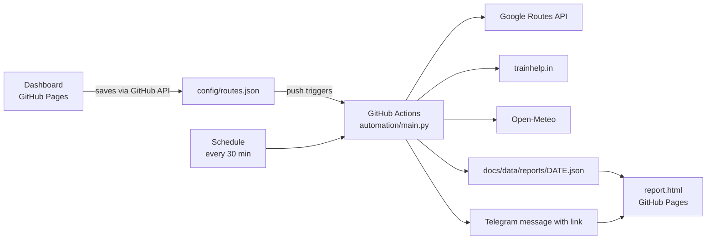

# CommuterAI

**Live Project:** [CommuterAI](https://muralibala2007.github.io/CommuterAI)

A personal commute assistant that runs entirely on **GitHub Actions** and **GitHub Pages**. You set your daily routes on a dashboard. Each morning the bot checks live traffic and public transport, then sends a **Telegram message** with the fastest option and a link to a detailed report.

> Built for a single user. There is no server, no database and nothing to host. The repository is the backend.

---

## Features

- **Route dashboard** with light and dark themes. Add, edit and remove routes, and every change is saved to GitHub automatically.
- **Map view.** Select a route to see it on a Google map, with tabs for Bus / Train, Car and Bike.
- **Daily Telegram alert** sent shortly before you leave. It includes the fastest option, the traffic delay and the next local trains, plus a link to the full report.
- **Traffic-aware times** for car and bike, shown next to the time without traffic.
- **Public transport steps.** Which bus or train, where to board, where to get off, number of stops and departure time.
- **Mumbai local train times** from the [trainhelp.in timetable](https://www.trainhelp.in/mumbai-local-train-time-table/) (best effort).
- **Weather at the destination** from Open-Meteo, including a rain flag.
- **Report page** that lists your routes with minimal information. Click one to see full details.
- **Per-route schedule.** Choose the leave time, the days of the week and the travel modes for each route.
- **Instant preview.** Saving a route builds its report straight away, without sending a Telegram message.

---

## How it works



1. You add a route on the dashboard. It commits `config/routes.json` to the repository using your token.
2. That commit starts the workflow in **preview mode**. It builds the report but does not send a Telegram message.
3. On a schedule, the workflow checks which routes are due (45 minutes before the leave time, on the chosen days, once per day). For each one it calls the Google Routes API, builds the report and sends the Telegram message.
4. The workflow commits the report JSON back to the repository, and GitHub Pages publishes it.
5. Opening the Telegram link shows the report list. Click a route for the full details.

---

## Project structure

```
CommuterAI/
├── .github/workflows/daily.yml   Schedule, push and manual triggers
├── automation/
│   ├── main.py                   Fetches routes and weather, builds the report, sends Telegram
│   └── trains.py                 Best-effort local train timetable lookup
├── config/routes.json            Your routes (edited by the dashboard)
├── docs/                         GitHub Pages site
│   ├── index.html                Dashboard and map
│   ├── report.html               Report list and route details
│   ├── style.css                 Shared theme
│   └── data/
│       ├── latest.json           Most recent report
│       └── reports/DATE.json     Daily reports (last 14 days kept)
├── state/sent.json               Records which routes were already sent today
└── requirements.txt
```

---

## Tech stack and APIs

| Part | Technology |
| --- | --- |
| Automation | Python 3.12, `requests`, `beautifulsoup4` |
| Scheduling and hosting | GitHub Actions, GitHub Pages |
| Routing and traffic | Google **Routes API** (`DRIVE`, `TWO_WHEELER`, `TRANSIT`) |
| Map in the dashboard | Google Maps embed (keyless by default, official Embed API if you add a key) |
| Weather | [Open-Meteo](https://open-meteo.com/) (no key needed) |
| Train times | trainhelp.in (scraped) |
| Notifications | Telegram Bot API |
| Frontend | Plain HTML, CSS and JavaScript, no build step |

---

## Setup

### 1. Get the code

Fork or clone this repository. Make sure the workflow file is at `.github/workflows/daily.yml`.

### 2. Turn on GitHub Pages

Go to **Settings → Pages**, choose **Deploy from a branch**, then branch `main` and folder `/docs`. Your site will be at `https://<username>.github.io/<repo>`.

### 3. Create a Google Maps key

1. In [Google Cloud Console](https://console.cloud.google.com/), create a project and enable billing. Google offers a monthly free allowance, so a few routes a day should stay within it. Check your quota to be sure.
2. Enable the **Routes API**.
3. Create an API key and restrict it to the Routes API.

Optional: enable the **Maps Embed API** and use a separate key for the dashboard map. Restrict that key to your site address, because it is visible in the browser.

### 4. Create the Telegram bot

1. Message [@BotFather](https://t.me/BotFather), send `/newbot` and copy the bot token.
2. Send any message to your new bot.
3. Open `https://api.telegram.org/bot<TOKEN>/getUpdates` and copy your `chat.id`.

### 5. Add secrets and variables

In **Settings → Secrets and variables → Actions**:

| Type | Name | Value |
| --- | --- | --- |
| Secret | `GOOGLE_MAPS_API_KEY` | Your Routes API key |
| Secret | `TELEGRAM_BOT_TOKEN` | Token from BotFather |
| Secret | `TELEGRAM_CHAT_ID` | Your chat id |
| Variable (optional) | `PAGES_URL` | `https://<username>.github.io/<repo>` |

If `PAGES_URL` is not set, the link is built from the repository name automatically. Set it if you use a custom domain.

### 6. Create a token for the dashboard

The dashboard saves routes by committing to your repository, so it needs a token.

1. Go to **GitHub → Settings → Developer settings → Fine-grained tokens**.
2. Limit it to this repository only.
3. Give it **Contents: Read and write**.
4. Open the dashboard, choose **Settings**, and enter `owner/repo`, the branch, the token and (optionally) the Maps Embed key.

The values are stored only in your browser.

### 7. Test it

Go to **Actions → Daily commute alert → Run workflow**, tick **force**, and run it. You should receive the Telegram message within a minute or two.

---

## Usage

### Dashboard

- **Add route** opens a form with name, from, to, leave time (hour, minute, AM/PM), days, travel modes and optional local train stations.
- Click a route to see it on the map. Switch between Bus / Train, Car and Bike.
- **Edit** and **Remove** change `config/routes.json` in GitHub straight away. A status line shows whether the save worked.
- **Report** opens the report page.

### Report page

- The default view lists your routes with the fastest option, the leave time and any traffic or rain notes.
- Click a route to see every option, step-by-step transit details, local train times and weather.
- Use `report.html?d=YYYY-MM-DD` to open a specific day. A link such as `report.html#route-id` opens one route directly.

### Workflow triggers

| Trigger | What happens |
| --- | --- |
| Schedule, every 30 minutes from 05:30 to 12:00 IST | Sends the alert for routes that are due, once per day |
| Push that changes `config/routes.json` | Builds the report only, with no Telegram message |
| Manual run with **force** | Builds the report and sends the alert for all routes now |

---

## Route configuration

`config/routes.json` is normally edited by the dashboard, but you can edit it by hand.

```json
{
  "routes": [
    {
      "id": "home-office",
      "name": "Home to office",
      "origin": "Thane Railway Station, Thane, Maharashtra",
      "destination": "Bandra Kurla Complex, Mumbai",
      "depart_time": "08:30",
      "days": [0, 1, 2, 3, 4],
      "modes": ["transit", "drive", "two_wheeler"],
      "train": { "from": "Thane", "to": "Dadar" }
    }
  ]
}
```

| Field | Description |
| --- | --- |
| `id` | Unique id for the route |
| `name` | Display name |
| `origin`, `destination` | Any address or place name Google can find |
| `depart_time` | 24-hour `HH:MM`, in India Standard Time |
| `days` | Days of the week, `0` is Monday and `6` is Sunday |
| `modes` | Any of `transit`, `drive`, `two_wheeler` |
| `train` | Optional. Station names to look up in the local train timetable |

---

## Run locally

```bash
pip install -r requirements.txt

export GOOGLE_MAPS_API_KEY=your_key
export TELEGRAM_BOT_TOKEN=your_token
export TELEGRAM_CHAT_ID=your_chat_id
export PAGES_URL=https://<username>.github.io/<repo>   # optional

FORCE=true python automation/main.py       # build the report and send now
PREVIEW=true python automation/main.py     # build the report only
```

On Windows, install the time zone data first with `pip install tzdata`. Never commit a `.env` file or any keys. This repository's `.gitignore` already excludes `.env`.

---

## Limitations and notes

- **Train timetable is scraped.** trainhelp.in has no API, so the lookup can break if the site layout changes. When it fails, the report still shows the train legs from Google.
- **Bike map.** Google has no cycling routes for most of India, so the Bike tab draws the road route. The bike time in the report comes from Google's separate two-wheeler routing. Google marks two-wheeler routes as beta, so the path can differ from the one you ride.
- **The keyless map embed is unofficial.** Add a Maps Embed API key in Settings for the supported version.
- **Public site.** GitHub Pages is public, so your route names, addresses and reports are visible to anyone with the link. Use generic place names if that matters to you.
- **Schedule timing.** GitHub cron can start several minutes late. The once-per-day record in `state/sent.json` prevents duplicate messages.
- **Time zone.** Schedules and dates use India Standard Time.
- **Single user.** Everything is built for one person and one Telegram chat.

---

## Troubleshooting

| Problem | Fix |
| --- | --- |
| Telegram message arrives without a link | Set the `PAGES_URL` variable, or check that Pages is enabled |
| Report says "No report for this date yet" | Wait 1 to 2 minutes for Pages to publish, then refresh. Check the **Actions** tab for a failed run |
| Dashboard says GitHub rejected the save | Check the repo name, branch, and that the token has **Contents: Read and write** for this repo |
| No alert arrives in the morning | Check the route's days and leave time, and that the alert was not already sent today in `state/sent.json` |
| A mode is missing from the report | Google returned no route for that mode, so check the addresses. See the Actions log |
| Map shows only pins | Pick a different tab, or add a Maps Embed API key in Settings |

---

## Ideas for the future

- Evening return-trip alert
- "Leave now or wait" advice when traffic is getting worse
- A chart of your usual commute times to find the best departure window
- Support for more than one Telegram chat

---

## License

Add a `LICENSE` file to choose how others may use this project.
